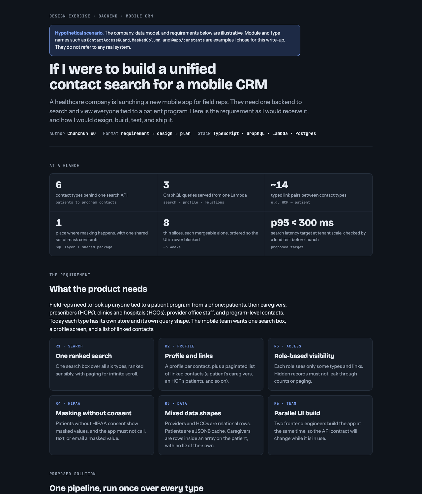

# If I Were to Create a Mobile Search

**Live page:** https://claude.ai/artifact/1KJzmLteTKNPYHVLYaLqLb (same content as [`index.html`](index.html))

> **Hypothetical scenario.** The company, data model, and requirements here are illustrative. Module and type names such as `ContactAccessGuard`, `MaskedColumn`, and `@app/constants` are examples chosen for this write-up and do not refer to any real system. Latency figures and the timeline are proposed targets, not measurements.

A design exercise: a healthcare company is launching a new mobile CRM for field reps and needs one backend to search and view everyone tied to a patient program. This repo states the requirement and walks through how I would design, build, test, and ship it.

## Contents

| File | What it is |
| --- | --- |
| [`index.html`](index.html) | The full write-up: requirements, proposed pipeline, five design decisions, delivery plan, and risks. Open it in a browser. |

## The requirement

| ID | Need |
| --- | --- |
| R1 · Search | One ranked, paginated search box over six contact types: patients, caregivers, HCPs, HCOs, provider office staff, and program contacts |
| R2 · Profile | A profile per contact, plus a paginated list of linked contacts |
| R3 · Access | Each role sees only some types and links, with no leaks through counts or paging |
| R4 · HIPAA | Patients without consent show masked values, and the app can't contact a masked value |
| R5 · Data | Relational rows (providers, HCOs), a JSONB cache (patients), and caregivers nested in an array with no ID of their own |
| R6 · Team | Two frontend engineers build the app in parallel, so the contract changes while it is in use |

## How I'd solve it

One pipeline, run once over every type: GraphQL resolver → validate and sanitize → authorize per type → name CTE per entity → match and rank → page → attach links → mask and convert. Three GraphQL queries (`searchContacts`, `contactProfile`, `contactRelations`) are served from one Lambda.

1. **Engineering: one query over six data shapes.** Each entity gets a CTE that emits the same columns, so matching, ranking, paging, and link expansion are written once. Caregivers get a composite key with a shared delimiter constant. Links are ~14 explicit typed pairs. An access guard decides allowed types and links before any SQL is built.
2. **Product instinct and execution: plan for the requirements to move.** Ranking is a documented, ordered list that can grow: case-insensitive, exact matches first, last name, primary links first, with masked names sorting as empty. A shared `Page` interface, additive changes, and staged deprecations keep the mobile client from breaking.
3. **Simplification: mask once, at the source.** Sensitive columns are masked inside the SQL. The masks live in one shared constants module used by backend and frontend, built from sentinels that can't collide with real data, so the UI can detect them with a set lookup.
4. **Verification: tests, end-to-end, and load.** About 2 test lines per production line against a real Postgres test database, a table-driven permission matrix, Playwright flows for the mobile app, latency timers in the request path, and a k6 load test gated on p95 < 300 ms before launch.
5. **Planning: thin, safe slices.** Eight slices over about six weeks, in the order DAO → API → paging → access guard → masking → profile → relations → ranking and load test. Each one lands before the UI needs it.
